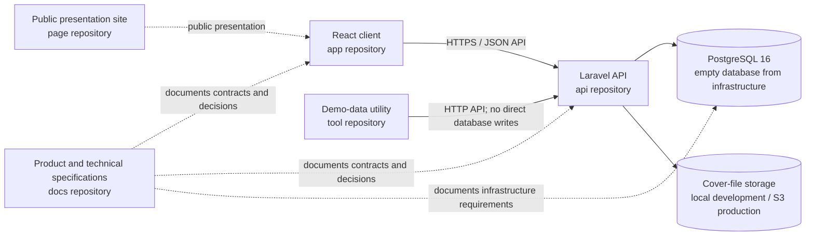

# Architecture Overview

**Status: Ready for implementation.** This overview shows the responsibilities of the six project repositories. The detailed Laravel component boundaries are in [`architecture.md`](architecture.md).

| Repository responsibility | Boundary |
|---|---|
| `test-manager-library-3145555-docs` | User stories, data model, API contract, architecture, decisions, and task evidence |
| `test-manager-library-3145555-api` | Laravel backend, API implementation, migrations, and backend tests |
| `test-manager-library-3145555-app` | React frontend; communicates with the API through its HTTP contract |
| `test-manager-library-3145555-page` | Static public presentation site |
| `test-manager-library-3145555-infra` | Containers, network, volumes, and an empty PostgreSQL service; no application schema DDL |
| `test-manager-library-3145555-tool` | Demo-data utility that uses the public API and does not write directly to PostgreSQL |

Repository names and the overall React/Laravel target must remain aligned with the root README. The docs repository is authoritative for product behavior and contracts; implementation repositories must conform to those documents.
