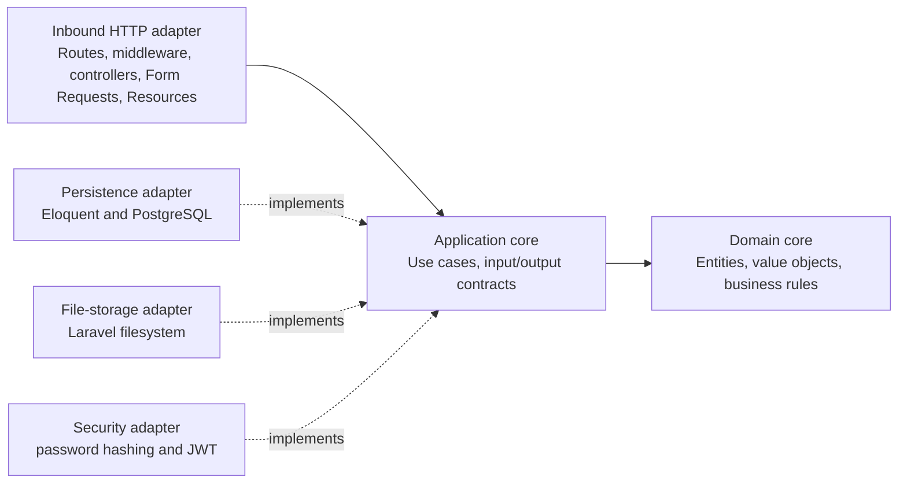

# Laravel Architecture

**Status: Ready for implementation.** The target follows hexagonal architecture adapted to Laravel, as recorded in [ADR-005](adr/adr-005-hexagonal-architecture.md). It retains the domain, application, and adapter boundaries in the .NET reference without copying its project layout or framework-specific types.

## 1. Components and dependency rules



- Dependencies point inward. Domain code does not depend on Laravel, Eloquent, HTTP, storage drivers, or JWT libraries.
- The application layer coordinates use cases and defines ports for external capabilities it consumes, including persistence, time, cover storage, password hashing, and token issuance.
- Inbound HTTP components translate HTTP requests into application inputs and map application outcomes to the response contract. They do not contain product rules.
- Outbound adapters implement application ports. Eloquent models and database queries remain in the persistence adapter; filesystem and token details remain in their respective adapters.
- Bind ports to adapters through Laravel service providers. Avoid duplicating Laravel's container with a separate composition framework.
- Keep abstractions purposeful. Do not create a port for a dependency that has no independent boundary or testing need.

## 2. Proposed application structure

```text
app/
├── Domain/
│   ├── Books/                 # Book rules and ISBN value object
│   ├── Loans/                 # Loan, LoanItem, loan status and rules
│   ├── Members/               # Member rules and document number value object
│   └── Users/                 # User and role rules
├── Application/
│   ├── Contracts/             # Outbound ports owned by the application
│   ├── Data/                  # Use-case input and output data objects
│   └── UseCases/              # One focused class per product operation
├── Adapters/
│   ├── Inbound/Http/          # Controllers, Form Requests, Resources, middleware
│   └── Outbound/
│       ├── Persistence/       # Eloquent models, repositories, report queries
│       ├── Storage/           # Cover storage implementation
│       └── Security/          # Password hasher and JWT issuer
├── Exceptions/                # HTTP exception mapping to api-contract.md
└── Providers/                 # Port-to-adapter bindings
```

The tree is a logical organization within a Laravel application, not a mandate to create separate Composer packages. Use singular `PascalCase` class names and English `camelCase` methods in line with [`constitution.md`](constitution.md). Eloquent models map explicitly or conventionally to the plural tables in [`data-model.md`](data-model.md).

## 3. Loan creation workflow and transaction boundary

1. Authenticate the request and verify the `admin` or `librarian` role.
2. Validate the request shape and resolve the member and requested books.
3. Start one PostgreSQL transaction and lock the member row.
4. Recheck that member's unreturned-item count and overdue status while holding the member lock.
5. Lock the requested active book rows in ascending book-ID order and recheck availability, as specified in [ADR-002](adr/adr-002-concurrency-control.md).
6. Decrement each book's available count, create the loan, and create its snapshot items in the same transaction.
7. Commit and return the created loan with its items. Any failure rolls back every write and maps to the API error contract.

Returning an item also updates `returned_at` and increments the corresponding available count atomically. A duplicate return must not increment the count twice.

## 4. Error handling and authorization

- Authentication and role middleware protect routes according to [`api-contract.md`](api-contract.md).
- Form Requests validate transport-level shape and constraints. Domain/application use cases enforce product invariants and return typed outcomes or application exceptions.
- A single HTTP boundary maps validation, business, authorization, and not-found failures to the documented status, error code, and response body. Unexpected exceptions must not expose stack traces, SQL, or filesystem paths; apply the API contract's common error-envelope rule.
- Do not let Laravel or database exception text leak to API clients.

## 5. Cover storage and lifecycle

The application depends on a cover-storage port; its adapter uses Laravel's filesystem abstraction. Use the local disk in development and S3 in production. The database stores only the opaque `cover_key`. Upload validation checks JPEG or PNG content and the 2 MB limit. Deletion clears and commits the database key before deleting the binary, as specified in [`data-model.md`](data-model.md).

## 6. Explicitly out of architecture scope

Do not add queues, event buses, caches, microservices, multi-tenancy, or additional persistence entities unless an approved product requirement requires them.
