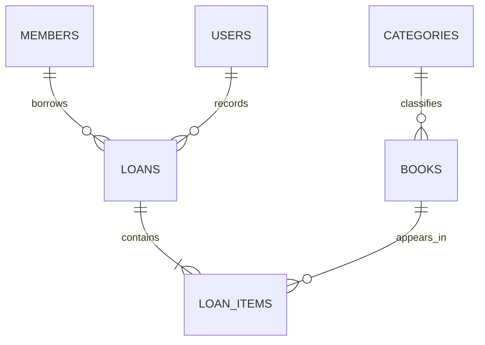

# Data Model — Manager Library

**Status: Draft.** This is the single source of truth for persistent entities and database structure. It follows the approved Laravel naming choice: plural table names, `snake_case` columns, and no entity prefix.

- **Reference database:** PostgreSQL 16.
- **Database schema:** `library`.
- **Time zone:** Store business timestamps as UTC instants using `timestamptz`.
- This document is governed by [`constitution.md`](constitution.md) and [`spec.md`](spec.md). If another document disagrees about a persistent field or constraint, this document owns the data-model definition; the conflict must still be corrected in the other document.
- The application generates UUID v4 identifiers. No column has a database `DEFAULT`; the application supplies values explicitly.

## 1. Naming conventions

| Element | Convention | Example |
|---|---|---|
| Database table | English plural, `snake_case`, no prefix | `loan_items` |
| Database column | English, `snake_case` | `due_at`, `total_copies` |
| Foreign key column | Referenced entity's singular name plus `_id` | `member_id` |
| Check constraint | `ck_{table}_{rule}` | `ck_books_available_range` |
| Index | `ix_{table}_{columns}` or `uq_{table}_{columns}` for unique indexes | `uq_members_document_number` |
| PostgreSQL schema | `library` | `library.books` |

Laravel model classes use singular PascalCase names (`Book`, `LoanItem`). Eloquent's table mapping follows the plural names above. The API uses the `snake_case` fields defined in [`api-contract.md`](api-contract.md).

## 2. Glossary and entities

| Entity | Definition | Table |
|---|---|---|
| **Book** | Catalog title with author, ISBN, category, copy counts, and an optional cover key | `books` |
| **Category** | One of five fixed, seeded categories; not managed through write operations | `categories` |
| **Member** | Person who borrows books and does not sign in | `members` |
| **Loan** | Record of which member borrowed items, which user recorded it, and when | `loans` |
| **Loan item** | One book within a loan, with due date, return time, and catalog-value snapshots | `loan_items` |
| **User** | Internal operator with the `admin` or `librarian` role | `users` |
| **Loan status** | `open`, `overdue`, or `closed`; calculated and not stored | No column |

## 3. Relationships



There are six persistent entities and six tables. There are no report, fine, or audit tables.

## 4. Physical schema

### `categories`

Seeded reference data. Category names are unique.

| Column | Type | Nullable | Definition |
|---|---|---|---|
| `id` | `uuid` | No | Primary key; fixed UUID for each seeded category |
| `name` | `varchar(120)` | No | Unique category label |

### `books`

| Column | Type | Nullable | Definition |
|---|---|---|---|
| `id` | `uuid` | No | Primary key |
| `title` | `varchar(250)` | No | Trimmed by the application domain |
| `author` | `varchar(200)` | No | Book author |
| `isbn` | `char(13)` | No | 13 digits; unique among active books |
| `category_id` | `uuid` | No | Foreign key to `categories.id`, with `RESTRICT` on delete |
| `total_copies` | `integer` | No | At least 1 |
| `available_copies` | `integer` | No | Between 0 and `total_copies`, inclusive |
| `cover_key` | `varchar(512)` | Yes | Opaque storage key; never a path, binary value, or empty string |
| `deleted_at` | `timestamptz` | Yes | Soft-delete timestamp; `NULL` means active |

### `members`

| Column | Type | Nullable | Definition |
|---|---|---|---|
| `id` | `uuid` | No | Primary key |
| `full_name` | `varchar(200)` | No | Member's full name |
| `document_number` | `varchar(30)` | No | Unique member document number |

### `loans`

| Column | Type | Nullable | Definition |
|---|---|---|---|
| `id` | `uuid` | No | Primary key |
| `member_id` | `uuid` | No | Foreign key to `members.id`, with `RESTRICT` on delete |
| `loaned_by_user_id` | `uuid` | No | Foreign key to `users.id`, with `RESTRICT` on delete |
| `loaned_at` | `timestamptz` | No | UTC instant when the loan was recorded |

### `loan_items`

| Column | Type | Nullable | Definition |
|---|---|---|---|
| `id` | `uuid` | No | Primary key |
| `loan_id` | `uuid` | No | Foreign key to `loans.id`, with `CASCADE` on delete |
| `book_id` | `uuid` | No | Foreign key to `books.id`, with `RESTRICT` on delete |
| `book_title` | `varchar(250)` | No | Title snapshot; same maximum length as `books.title` |
| `isbn` | `char(13)` | No | ISBN snapshot |
| `category_name` | `varchar(120)` | No | Category-name snapshot; intentionally has no foreign key |
| `due_at` | `timestamptz` | No | `loaned_at` plus 14 days, calculated by the application |
| `returned_at` | `timestamptz` | Yes | `NULL` while the item has not been returned |

### `users`

| Column | Type | Nullable | Definition |
|---|---|---|---|
| `id` | `uuid` | No | Primary key |
| `username` | `varchar(120)` | No | Unique, trimmed, and lowercase |
| `password_hash` | `varchar(512)` | No | Password hash; never indexed |
| `role` | `varchar(40)` | No | `admin` or `librarian` |

There are no `created_at` or `updated_at` columns because the product requirements do not request audit timestamps. Business timestamps are stored in `loans.loaned_at`, `loan_items.returned_at`, and `books.deleted_at`.

## 5. Constraints and indexes

| Invariant | Database object | Enforcement |
|---|---|---|
| Primary key on every table | Primary key constraint | Database |
| `categories.name` is unique | Unique index | Database |
| `members.document_number` is unique | Unique index | Database |
| `users.username` is unique | Unique index | Database |
| `books.isbn` is unique among active books | Partial unique index with `WHERE deleted_at IS NULL` | Database |
| `books.category_id` references `categories.id` | Foreign key, `RESTRICT` | Database |
| `loans.member_id` references `members.id` | Foreign key, `RESTRICT` | Database |
| `loans.loaned_by_user_id` references `users.id` | Foreign key, `RESTRICT` | Database |
| `loan_items.loan_id` references `loans.id` | Foreign key, `CASCADE` | Database |
| `loan_items.book_id` references `books.id` | Foreign key, `RESTRICT` | Database |
| `0 <= available_copies <= total_copies` | `ck_books_available_range` | Database; final integrity guard |
| `total_copies >= 1` | `ck_books_total_positive` | Application initially; add database constraint in the persistence-hardening task |
| `users.role` is `admin` or `librarian` | `ck_users_role` | Application initially; add database constraint in the persistence-hardening task |
| A book occurs at most once per loan | Unique index on `(loan_id, book_id)` | Database |
| A member has at most 3 unreturned books | No single-row check can enforce this aggregate rule | Application, within the loan transaction |
| A member with overdue items cannot borrow | Domain rule | Application, within the loan transaction |
| A loan has 1 to 3 items | Aggregate rule | Application |
| Creating a loan and decrementing available copies are atomic | Database transaction | Application and database |
| A loan is immutable except for an item's `returned_at` | No update or delete operation is exposed | Application |

The initial-loan operation must lock the relevant `books` rows in the database transaction before checking and decrementing available copies. The same transaction creates the loan and its items. The row-lock procedure and its consequences are recorded in [ADR-002](adr/adr-002-concurrency-control.md).

Recommended access indexes:

- `books(category_id, title)` for active catalog search.
- `loans(loaned_at)` for date-range searches.
- `loan_items(book_id)` for book history.
- `loan_items(due_at) WHERE returned_at IS NULL` for overdue-item queries.

## 6. Foreign-key deletion policy

| Relationship | Delete behavior | Reason |
|---|---|---|
| `books.category_id` | `RESTRICT` | A category referenced by a book cannot be deleted. |
| `loan_items.loan_id` | `CASCADE` | A loan item cannot exist without its loan; loan deletion is not exposed. |
| `loan_items.book_id` | `RESTRICT` | Prevents physical deletion from orphaning loan history. |
| `loans.member_id` | `RESTRICT` | A member referenced by a loan cannot be deleted. |
| `loans.loaned_by_user_id` | `RESTRICT` | Preserves the identity of the user who recorded the loan. |

All foreign keys use `ON UPDATE NO ACTION`; application-generated UUID keys do not change.

## 7. Access patterns

| ID | Query pattern | Expected frequency |
|---|---|---|
| Q1 | Search active books by text and category, ordered by title and paginated | High |
| Q2 | Get a book by ID | High |
| Q3 | Get a set of books by IDs before recording a loan | High; contention-sensitive |
| Q4 | List categories | High |
| Q5 | Get a loan with its items | Medium |
| Q6 | List loans by date range, status, and member | High |
| Q7 | Get a member's unreturned items and overdue items | High; used during loan creation |
| Q8 | List all overdue items | Medium |
| Q9 | Aggregate the most-borrowed report for a date range | High; most expensive query |
| Q10 | Find a user by username during sign-in | High |

## 8. Privacy and retention

| Table | Data | Classification | Handling |
|---|---|---|---|
| `users` | `username` | Personal data | Restricted access |
| `users` | `password_hash` | Secret | Never log, return, or index |
| `members` | `full_name`, `document_number` | Personal data | Accessible only to `admin` and `librarian`; excluded from reports and public endpoints |
| `loans`, `loan_items` | All fields | Business records; `member_id` is indirectly identifying | Retain indefinitely |
| `books`, `categories` | All fields | Catalog data | Books use soft deletion; categories are not deleted |

The most-borrowed report contains book and category snapshots, not member or librarian details.

Loans and loan items are never deleted. Books are soft-deleted. A cover binary is the only data physically removed: first clear `books.cover_key` and commit that database transaction, then delete the binary from storage.

## 9. Seed data and initial administrator

Five fixed categories are inserted by the initial database migration using stable UUIDs. Their labels remain unchanged product data from the existing specification; all explanatory documentation remains in English.

| UUID | Category label |
|---|---|
| `11111111-1111-4111-8111-111111111111` | `Novela` |
| `22222222-2222-4222-8222-222222222222` | `Ciencia` |
| `33333333-3333-4333-8333-333333333333` | `Tecnología` |
| `44444444-4444-4444-8444-444444444444` | `Historia` |
| `55555555-5555-4555-8555-555555555555` | `Infantil` |

The initial administrator is created by the Laravel application at startup from environment credentials; the database migration does not seed the account. The demo-data tool uses the API and does not write directly to the database.

## 10. Verification queries

```sql
-- Expected columns; no column should have a database DEFAULT.
SELECT table_name, ordinal_position, column_name, data_type, is_nullable, column_default
FROM information_schema.columns
WHERE table_schema = 'library'
ORDER BY table_name, ordinal_position;

-- Primary keys, foreign keys, and check constraints.
SELECT c.conrelid::regclass, c.conname, c.contype, pg_get_constraintdef(c.oid)
FROM pg_constraint c
JOIN pg_namespace n ON n.oid = c.connamespace
WHERE n.nspname = 'library'
ORDER BY 1, 3, 2;

-- Indexes.
SELECT tablename, indexname, indexdef
FROM pg_indexes
WHERE schemaname = 'library'
ORDER BY tablename, indexname;
```

Every invariant marked as database-enforced must appear in the schema. If an application-only invariant is later added to the database, update its enforcement classification and the related task documentation.
